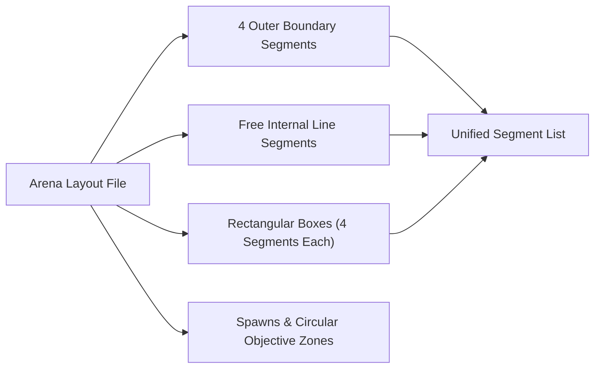

# 01. Configuration Philosophy & 2D Arena Design

**Navigation:** [Index](README.md) | **Next:** [02. Simulation & Perception](02_simulation_and_perception.md)

---

## 1. Why Data-Driven Configuration?

In reinforcement learning, small changes to movement speed, sensor range, episode length, or reward weights can dramatically alter emergent behavior. Hard-coding these numbers inside physics or training loops makes experiments slow, error-prone, and difficult to reproduce.

DECO-SWARM separates **mechanics** from **parameters**:
- **Safe Code Defaults:** Every subsystem defines sensible fallback defaults so components can still be instantiated in isolation during unit tests.
- **Declarative Overrides:** Human-readable configuration files override those defaults at startup, grouped cleanly by domain (`agent`, `simulation`, `environment`, `render`, and `arenas`).
- **Explicit Precedence:** Runtime arguments (such as CLI overrides for learning rate or episode horizon) take highest priority, followed by config files, and finally code defaults.

> [!TIP]
> When porting to JAX, parse all YAML/JSON configs **once** at startup into frozen, immutable parameter structures. Never read config files inside the compiled step loop.

---

## 2. The Four Configuration Domains

### 2.1 Agent Body & Perception
Controls the physical footprint, movement limits, and panoramic sensor of each agent:

| Parameter | Baseline Value | Units | Purpose |
| :--- | :--- | :--- | :--- |
| Collision radius | `10.0` | px | Circular hitbox radius used for wall and entity collisions |
| Max linear speed | `180.0` | px/s | Top forward, backward, and strafe speed |
| Angular turn rate | `200.0` | deg/s | Maximum rotation speed around the agent's center |
| Ray count | `90` | rays | Number of evenly spaced rays across the field of view |
| Field of view (FOV) | `180.0` | deg | Total angular span centered on the agent's heading |
| Max sensing range | `500.0` | px | Cutoff distance beyond which rays report no hit |

### 2.2 Physics Simulation
Controls numerical stability and collision accuracy:

| Parameter | Baseline Value | Units | Purpose |
| :--- | :--- | :--- | :--- |
| Physics tick rate | `60.0` | Hz | Fixed integration step ($\Delta t = 1/60\text{ s}$) |
| Collision relaxation passes | `2` | passes | Repeated push-out iterations per tick to resolve tight corners cleanly |

### 2.3 Episode Horizon & Reward Weights
Controls the RL Markov Decision Process (MDP) cadence and shaping incentives:

| Parameter | Baseline Value | Units | Purpose |
| :--- | :--- | :--- | :--- |
| Max decision steps | `300` | macro-steps | Episode truncation limit (30 seconds at 10 Hz) |
| Action repeat | `6` | substeps | Number of 60 Hz physics ticks executed per 10 Hz agent decision |
| Progress weight | `0.05` | reward/px | Multiplier for distance reduction toward the objective |
| Step time penalty | `0.0` | reward/step | Optional per-step living penalty (kept `0.0` to prevent early value bleed) |
| Collision penalty | `-0.15` | reward | Penalty applied once per macro-step if any substep hit a wall |
| Exploration weight | `0.10` | reward/cell | One-time bonus for entering an unvisited spatial grid cell |
| Exploration cell size | `80.0` | px | Spatial discretization size for episodic novelty tracking |
| Peak goal reward | `100.0` | reward | Maximum terminal reward for completing the objective |
| Goal time-decay | `0.8` | fraction | Portion of goal reward scaled by completion speed |
| Minimum goal ratio | `0.2` | fraction | Guaranteed floor fraction of goal reward even on slow completions |
| Timeout penalty | `-10.0` | reward | Terminal penalty when the episode truncates without success |

### 2.4 Viewer & Camera
Controls the optional interactive window (ignored during headless training):

| Parameter | Baseline Value | Units | Purpose |
| :--- | :--- | :--- | :--- |
| Window dimensions | `1024 × 720` | px | Display canvas size |
| Render frame cap | `60` | FPS | Target refresh rate for smooth visual inspection |
| Zoom range & default | `0.75` (`[0.2, 4.0]`) | scale | Initial camera magnification and clamping bounds |

---

## 3. Declarative 2D Arena Representation

Rather than maintaining separate collision math for rectangles, polygons, and borders, every 2D arena is compiled into a **single geometric primitive: a list of 2D line segments**.

An arena definition contains four logical blocks:
1. **Dimensions (`width`, `height`):** Defines the playable rectangular bounds (e.g., `1000 × 1000 px`). The loader automatically generates the **4 outer boundary segments** enclosing `[0, width] × [0, height]` so agents can never leave the map.
2. **Internal Walls & Boxes:**
   - *Free segments* (`(x1, y1) -> (x2, y2)`) represent angled walls, dividers, or corridors.
   - *Axis-aligned boxes* (`[x, y, w, h]`) are automatically decomposed into **4 line segments** (top, right, bottom, left).
3. **Spawn Points:** Initial `(x, y, heading_deg)` poses for each agent (or per-team spawn zones in multi-agent CTF).
4. **Objectives & Zones:** Circular regions defined by `(center_x, center_y, radius)`—representing a navigation goal in single-agent mode, or team bases and flag pedestals in Capture the Flag.



> [!IMPORTANT]
> **GPU Batching Requirement (v2):** Vectorized GPU engines cannot loop over variable-length lists per environment. When loading multiple arenas for parallel execution, pad every arena's segment array to a shared `MAX_SEGMENTS` capacity and accompany it with a boolean `segment_mask`. Both raycasting and collision resolution simply mask out padded entries branchlessly.

---

## 4. Reference Schemas (YAML)

Below are the canonical schemas used to serialize configurations and 2D arenas without coupling them to code:

### 4.1 Parameter Config Layout
```yaml
# Agent body & sensor parameters
body: { radius: 10.0, linear_speed: 180.0, angular_speed: 200.0 }
perception: { ray_count: 90, fov_degrees: 180.0, max_distance: 500.0 }

# Physics solver parameters
physics: { tick_rate: 60.0, collision_iterations: 2 }

# Episode & reward shaping parameters
episode: { max_steps: 300, action_repeat: 6 }
rewards:
  progress_weight: 0.05
  time_penalty: 0.0
  collision_penalty: -0.15
  exploration_weight: 0.10
  cell_size: 80.0
  goal_reward: 100.0
  goal_time_decay: 0.8
  min_goal_ratio: 0.2
  timeout_penalty: -10.0
```

### 4.2 Arena Map Layout
```yaml
name: "two_box_corridor"
dimensions: { width: 1000, height: 1000 }
spawns:
  agent_0: [200.0, 200.0, 45.0]   # [x, y, heading_deg]
goal:
  position: [800.0, 800.0]
  radius: 32.0
walls:
  segments:
    - [[450, 550], [550, 450]]    # Free line segment [[x1, y1], [x2, y2]]
  boxes:
    - [250, 550, 200, 200]        # Axis-aligned box [x, y, width, height]
```

In **v2 Capture the Flag**, the `spawns` and `goal` blocks extend to symmetric `red_team` / `blue_team` spawn zones, flag pedestals, and home bases so neither side gets a geometric advantage.

---

**Navigation:** [Index](README.md) | **Next:** [02. Simulation & Perception](02_simulation_and_perception.md)
