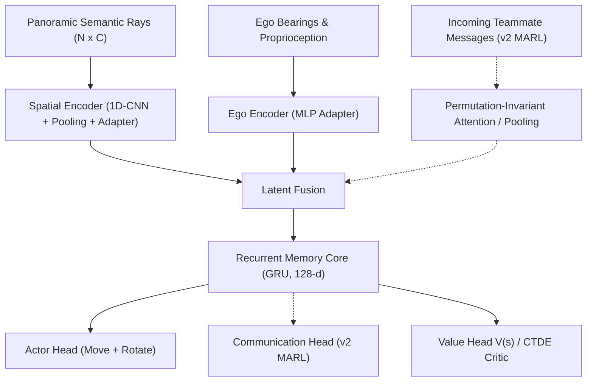

# 04. Modular Agent Architecture, Recurrent PPO & Checkpoint Safety

**Navigation:** [Index](README.md) | **Previous:** [03. Environment, Rewards & Curriculum](03_environment_rewards_and_curriculum.md) | **Next:** [05. Visualization & Interaction](05_visualization_and_interaction.md)

---

## 1. Modular Late-Fusion Network Design

Feeding raw panoramic raycasts and scalar telemetry into a single flat MLP forces the network to learn spatial geometry and kinematic vitals together from scratch. DECO-SWARM uses a **modular late-fusion recurrent architecture** that separates heterogeneous modalities before fusing them into temporal memory:

### Key Architectural Properties & Baseline Dimensions
- **Spatial Stream (1D-CNN):** Treats the ordered `(90, 7)` panoramic rays as a 1D scan: `Conv1d(7→32, k=5, s=2, p=2) → ReLU → Conv1d(32→64, k=3, s=2, p=1) → ReLU → AdaptiveAvgPool1d(8) → Flatten(512) → Linear(512→128) → ReLU`. This detects openings, corners, and spotted entities regardless of their angle in the field of view.
- **Ego Stream (MLP Adapter):** Projects the `10` scalar bearings, velocities, previous action, and status vitals via `Linear(10→32) → ReLU → Linear(32→32) → ReLU`.
- **Recurrent Belief Core (GRU):** Concatenates the spatial and ego embeddings (`128 + 32 = 160`) with the previous hidden state $h_{t-1}$ into a `GRU(160→128)` cell to output $h_t \in \mathbb{R}^{128}$. This gives the agent short-term spatial memory to escape dead-ends, remember occluded obstacles, and track opponents that leave its 180° cone.
- **Actor & Critic Heads:** Two `Linear(128→64) → ReLU` backbones branch into multi-discrete policy logits (`move: 5`, `rotate: 3`) and scalar value $V(s)$ (`Linear(64→1)`).
- **Multi-Agent Extension (v2 CTF + Communication):** Because encoders and heads interact through clean latent adapters, adding multi-agent communication requires **no redesign of the core**:
  - An **attention or pooling branch** aggregates incoming messages from an arbitrary number of teammates, keeping the policy **team-size invariant** (train on 2v2/3v3, generalize to 5v5).
  - A **communication head** emits a compact message vector alongside the motor actions.
  - During training, a **Centralized Critic (CTDE)** can condition on global arena state (all agent poses, flag positions, and cooldowns) to stabilize advantage estimation while deployed actors remain 100% decentralized.

---

## 2. Recurrent PPO & Memory Hygiene

Training uses **Proximal Policy Optimization (PPO)** with **Generalized Advantage Estimation (GAE)**:

1. **Rollout Collection:** Parallel environments step for $T$ macro-steps (`256`–`1000`), recording observations, actions, rewards, `done` flags, log-probabilities, value estimates, and recurrent hidden states.
2. **Advantage Estimation:** GAE runs backward from $t = T - 1$ to $0$, weighting TD errors $\delta_t = r_t + \gamma V(s_{t+1})(1 - d_t) - V(s_t)$ by $\gamma \lambda$. Advantages are normalized across the **entire rollout buffer** via $(\text{adv} - \mu) / (\sigma + 10^{-8})$ (not per minibatch, which would distort gradient scales on small batches).
3. **Chunked Sequence Updates:**
   - First, the non-recurrent encoders (1D-CNN + Ego MLP) run in **one parallel pass** over all $(T \times B)$ flattened steps.
   - Next, trajectories are sliced into fixed-length sequence chunks (`32` steps), shuffled across minibatches, and unrolled sequentially through the GRU over `4` epochs using clipped policy loss, clipped value loss $\frac{1}{2}\max\!\big((V - R)^2,\; (V_{\text{clip}} - R)^2\big)$, an entropy bonus, and gradient norm clipping:

| Hyperparameter | Baseline Value | Purpose |
| :--- | :--- | :--- |
| Optimizer & LR | `Adam`, `3e-4` (`eps=1e-5`) | Stable policy & value updates (annealed to `5e-5` for fine-tuning) |
| Discount & GAE | `gamma = 0.99`, `gae_lambda = 0.95` | Balances long-horizon credit assignment with variance |
| PPO Clip & Value | `clip_coef = 0.2`, `vf_coef = 0.5` | Bounds policy step size and weights value regression |
| Entropy & Grad Norm | `ent_coef = 0.01`, `max_grad_norm = 0.5` | Sustains exploration and prevents recurrent gradient spikes |
| Unroll & Epochs | `chunk_len = 32`, `update_epochs = 4` | Truncated BPTT window length and passes per rollout |

> [!IMPORTANT]
> **Two Classic Recurrent PPO Bugs to Never Repeat:**
> 1. **Pre-Step Hidden State:** Always store the hidden state **before** running the policy forward pass at step $t$ into the rollout buffer—storing the *post-step* state creates a 1-step temporal shift during training updates.
> 2. **Episode Boundary Masking:** Whenever an episode finishes at step $t-1$, multiply the hidden state by `(1 - done[t - 1])` before step $t$ so memories from a finished episode never leak into the start of a new episode.

---

## 3. The 5-Rule Checkpoint & Collapse-Recovery System

Reinforcement learning policies—especially recurrent ones transitioning between curriculum stages—can occasionally suffer sudden gradient spikes or catastrophic forgetting. To prevent losing hours of progress without flooding disk storage, training enforces **five ordered checkpoint rules** on every epoch:

1. **Stage Graduation Snapshot (Before Next Update):**
   Whenever the curriculum promotes to a harder stage during rollout collection, the trainer **immediately** saves the model *before* running the next gradient update (`graduated_stage_X`, plus updating `best_stage_X` and global `best`). This guarantees an untouched snapshot of the exact policy that mastered Stage $X$.
2. **Stage-Scoped Milestone Tracking:**
   Each curriculum stage tracks its own independent peak success rate. A new milestone checkpoint is written only when the evaluation window is full, success rate clears a meaningful proficiency floor (`>= 70%`), and it beats that stage's previous peak by at least **`+10%`**. This captures real breakthroughs while avoiding noisy saves on 1% fluctuations.
3. **Intra-Stage Collapse Protection (Rollback + LR Annealing):**
   Entering a brand-new stage naturally starts near `0%` success—so the system **never** compares success rates across different stages. Rollback triggers *only* if all three conditions hold within the **same** stage:
   - The agent already proved proficiency on this stage (`stage_peak >= 70%`),
   - It has completed enough episodes in this stage (`>= 40`) to rule out initial jitter, and
   - Rolling success rate suddenly plunges to `<= 20%`.
   When triggered, the trainer restores that stage's best saved weights, **halves the learning rate (`lr *= 0.5`)**, and clears the rolling evaluation windows.
4. **Periodic & Full-State Resume Checkpoints:**
   Every fixed step interval (e.g., `10,000` steps), a snapshot is saved containing `model_weights`, `optimizer_state`, `global_step`, `curriculum_stage`, `stage_peak`, and `rng_state` so interrupted runs can resume seamlessly without losing optimizer momentum, step counts, or stage progress (while still allowing an explicit stage flag to override the saved stage when desired).
5. **Rolling Latest & Final Snapshots:**
   A rolling `latest` checkpoint is refreshed at each save interval, and a clean `final` checkpoint is written when training completes.

---

**Navigation:** [Index](README.md) | **Previous:** [03. Environment, Rewards & Curriculum](03_environment_rewards_and_curriculum.md) | **Next:** [05. Visualization & Interaction](05_visualization_and_interaction.md)
