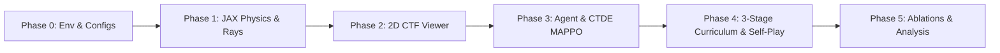

# 06. v2 Development Roadmap (Pure-JAX CTF & Communication)

**Navigation:** [Index](README.md) | **Previous:** [05. Visualization & Interaction](05_visualization_and_interaction.md)

---

## Overview

This roadmap outlines the phased engineering plan for building **DECO-SWARM v2**—a pure-JAX 2D Capture the Flag (CTF) simulator and Multi-Agent Reinforcement Learning (MARL) framework with learned inter-agent communication—using the architecture principles in chapters `01`–`05`.

---

## Phase 0: Environment & Project Skeleton

1. **Fresh Python + JAX Environment:**
   - Create a clean virtual environment with CUDA-enabled `jax[cuda12]`, `flax`, `optax`, `orbax-checkpoint` (or `safetensors`), `pyyaml`, `numpy`, and `pygame` (viewer only).
   - Verify GPU acceleration (`jax.devices()`) on the target RTX 3070 Laptop GPU.
2. **Repository Layout & Config Schemas:**
   - Establish modular packages: `src/configs/`, `src/sim/`, `src/envs/`, `src/models/`, `src/training/`, `src/rendering/`, and `tests/`.
   - Implement frozen, JAX-PyTree-compatible config dataclasses and YAML loaders for `agent`, `simulation`, `environment`, `render`, and symmetric Red/Blue CTF arenas.
- **Verification Gate:** Unit tests confirming YAML parsing, symmetric Red/Blue spawn/base/flag loading, and fixed-shape `MAX_SEGMENTS` padding + `segment_mask`.

---

## Phase 1: Pure-JAX Headless 2D CTF Physics & Perception (`src/sim/`)

1. **Immutable `EnvState` PyTree:**
   - Fixed-shape arrays for `N_agents` (positions, headings, velocities, previous actions, alive/health, respawn timers, flag-carrier state), `2` flags, `2` bases, and padded wall segments (`MAX_SEGMENTS`).
2. **60 Hz Kinematics & Sliding Collisions:**
   - Pure JAX kinematics (`rotate` + Quake-normalized `move`), 2-pass circle-segment sliding collision resolution (with `||d||^2 == 0` and `dist <= 1e-6` guards), and symmetric circle-circle agent push-out.
3. **CTF Game Mechanics:**
   - Circle-circle overlap for enemy flag pickup, drop on tag, and scoring at home base; proximity/LOS tagging with respawn cooldowns.
4. **10 Hz Semantic Raycast & Ego Observation:**
   - Vectorized (`jax.vmap`) 2D ray-segment + ray-circle intersections across `90` rays (`120°–180°` FOV), returning nearest normalized distance + semantic class (`wall`, `ally`, `enemy`, `flag`, `base`) + $(\cos\Delta\theta, \sin\Delta\theta)$.
   - Assemble the ego-centric observation tensor (rays + ego-polar home/flag bearings + proprioception + status).
- **Throughput Gate:** Wrap the 60 Hz substep loop (`action_repeat = 6`) in `jax.lax.scan` and `jax.vmap` across `256`–`1024` parallel arenas; verify **$\ge 10,000$ RL steps/sec** headless throughput and pass collision/raycast/CTF unit tests.

---

## Phase 2: Decoupled 2D CTF Viewer (`src/rendering/`)

1. **Read-Only State Snapshot Adapter:**
   - Extract a single arena's `EnvState` to host NumPy arrays once per rendered frame (never imported during training).
2. **Camera & 5-Layer CTF Drawers:**
   - Virtual 2D camera (pan, wheel zoom, smooth follow) and layered drawers: Red/Blue bases & flags, walls, toggleable semantic ray beams (`F1`), team-colored agents + heading vectors + communication indicators, and HUD telemetry.
3. **Interactive Modes:**
   - Support `--mode human` (keyboard sanity testing) and `--mode watch` (10 Hz deterministic policy playback with GRU hidden-state reset on `F2` or episode end).
- **Verification Gate:** Visually verify wall sliding, flag pickup/drop/score, and semantic ray hit colors.

---

## Phase 3: Modular Agent, Communication & CTDE MAPPO (`src/models/`, `src/training/`)

1. **Modular Late-Fusion Network:**
   - **Spatial Encoder:** `1D-CNN` + pooling + dense adapter over semantic rays.
   - **Ego Encoder:** `MLP` adapter over ego bearings, velocity, previous action, and status.
   - **Teammate Communication Branch:** Permutation-invariant **Multi-Head Attention / Mean-Max Pooling** over incoming teammate messages (enabling zero-shot `2v2` $\rightarrow$ `3v3` $\rightarrow$ `5v5` scaling).
   - **Recurrent Core:** `GRU(128)` fused over spatial + ego + pooled comms.
   - **Decentralized Heads & CTDE Critic:** Multi-discrete motor heads + communication vector head $m_t \in \mathbb{R}^d$, paired with a centralized critic conditioned on global arena state during training.
2. **Pure-JAX Recurrent MAPPO:**
   - Rollout collection inside `jax.lax.scan`, full-buffer GAE normalization (`gamma=0.99`, `gae_lambda=0.95`), `terminated` vs. `truncated` bootstrapping, pre-step hidden-state storage, `(1 - done)` boundary masking, and chunked sequence updates (`chunk_len=32`, `epochs=4`, `clip=0.2`).
3. **5-Rule Checkpoint & Collapse-Recovery System:**
   - Pre-update promotion graduation saves, stage-scoped milestones (`>= 70%`, `+10%`), intra-stage collapse rollback + `0.5×` LR annealing (`>= 40` episodes, `<= 20%`), periodic full-state resume saves, and `latest`/`final` snapshots.
- **Verification Gate:** Gradient & shape tests across `2v2`, `3v3`, and `5v5` team sizes; verify zero memory leakage across episode boundaries.

---

## Phase 4: 3-Stage Curriculum & Self-Play (`src/envs/curriculum.py`)

1. **Stage 1 — Solo/Duo Flag Navigation:** Master kinematics, obstacle avoidance, flag pickup, and return-to-base across randomized arenas.
2. **Stage 2 — Heuristic Bot Opponents:** Train `2v2` / `3v3` policies against scripted rule-based bots (attacker + defender behaviors).
3. **Stage 3 — Communication-Enabled League Self-Play:** Enable inter-agent communication and train against an **Opponent Pool** (`70%` latest self-play + `30%` historical snapshots) to prevent cyclic forgetting.
- **Verification Gate:** Consistent wins against heuristic bots in Stage 2 and stable win-rate progression in Stage 3 without policy collapse.

---

## Phase 5: Scientific Evaluation & Ablations

1. **Statistical Validation:** Run **5 random seeds** per configuration and compare win rates / capture times with **Mann-Whitney U tests**.
2. **Communication Causal Ablations:** Evaluate **channel-zeroing** (muting comms) and **message-shuffling** (randomizing teammate messages) to verify causal reliance on communication.
3. **Emergent Protocol Analysis & Scaling:** Measure zero-shot scaling (`2v2` $\rightarrow$ `3v3` $\rightarrow$ `5v5`) and analyze emitted messages $m_t$ via **PCA / t-SNE** + **K-Means & Silhouette** clustering.

---

**Navigation:** [Index](README.md) | **Previous:** [05. Visualization & Interaction](05_visualization_and_interaction.md)
