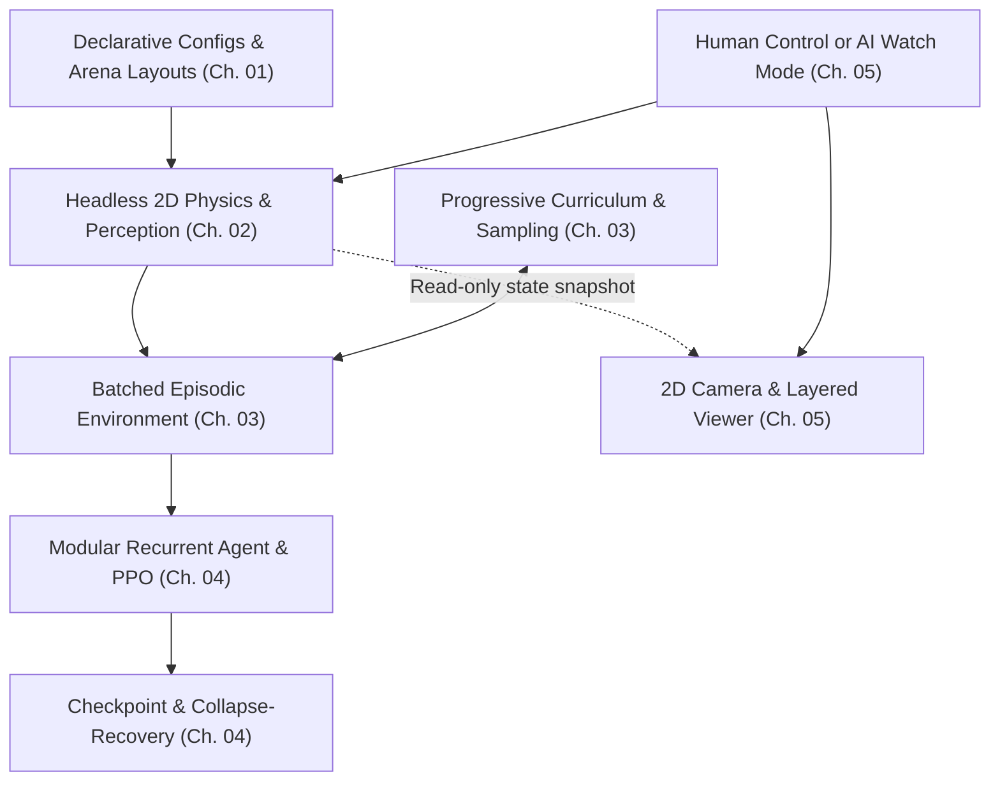

# DECO-SWARM — Architecture & System Documentation

> **Welcome:** This documentation explains how DECO-SWARM works from first principles—covering configuration, continuous 2D physics, ego-centric perception, reward shaping, recurrent reinforcement learning, checkpoint safety, and decoupled visualization. It is written to be **readable by humans** and **implementation-independent**, so the entire system can be cleanly re-built in **pure JAX** for **Multi-Agent Capture the Flag (CTF) with Learned Communication**.

---

## 1. Project Vision

DECO-SWARM trains autonomous agents to navigate, coordinate, and complete tactical objectives inside continuous 2D arenas under **partial observability**. Rather than relying on global coordinates or hard-coded pathfinding, each agent perceives the world strictly through a forward-facing panoramic raycast sensor, local proprioception, and—in multi-agent settings—a learned inter-agent communication channel.

To make reinforcement learning practical on a single consumer GPU, the system separates **headless high-throughput simulation** from **on-demand 2D visualization**. Training runs entirely without graphics, stepping hundreds of arenas in parallel, while a read-only viewer can attach at any time to inspect live trajectories, sensor rays, and agent behavior at 60 FPS.

---

## 2. Core Architectural Pillars

1. **Declarative Configuration & Arena Data:** Physical constants, sensor geometry, reward weights, and arena layouts live in structured configuration files outside the simulation code, allowing rapid experimentation without touching core logic.
2. **Two-Timescale Headless Simulation:** Continuous 2D kinematics and sliding wall collisions run at **60 Hz** to prevent tunneling, while policy inference and raycast perception run at **10 Hz** (`6` physics substeps per decision).
3. **Shaped Environment & Progressive Curriculum:** Dense potential-based shaping, episodic spatial novelty bonuses, and time-efficiency terminal rewards guide learning across progressively harder arena stages with per-episode domain randomization.
4. **Modular Recurrent Agent & Safe Checkpoint Lifecycle:** A late-fusion neural architecture pairs a 1D spatial encoder, scalar/ego encoders, and a recurrent memory core (`GRU`) trained with Recurrent PPO, protected by stage-scoped milestones and automatic collapse rollback.
5. **Read-Only Visualization & Interactive Modes:** A lightweight 2D camera and layered renderer observe simulation snapshots without mutating state, supporting both manual keyboard testing and deterministic AI playback.

---

## 3. End-to-End System Flow

The 8 runtime components below are organized into **5 cohesive chapters** (grouping tightly coupled pairs—Environment + Curriculum, Agent + Checkpoints, and Viewer + Controls—so each topic stays self-contained):

---

## 4. Documentation Index

Each chapter focuses on one self-contained layer of the system:

| Chapter | Focus | What You Will Learn |
| :--- | :--- | :--- |
| **[01. Configuration & Arenas](01_configuration_and_arenas.md)** | Parameters & Map Geometry | How tunable domains are structured and how arenas compile into unified 2D line segments. |
| **[02. Simulation & Perception](02_simulation_and_perception.md)** | Physics & Ego-Centric Sensors | Two-timescale stepping, sliding circle-wall collisions, semantic raycasting, polar bearings, and action decoding. |
| **[03. Environment, Rewards & Curriculum](03_environment_rewards_and_curriculum.md)** | MDP Loop & Training Progression | Action-repeat stepping, termination vs. truncation, shaped rewards, progressive stages, and parallel auto-reset. |
| **[04. Agent Architecture & Training](04_agent_architecture_and_training.md)** | Neural Design, PPO & Safety | Modular late-fusion + GRU design, recurrent PPO pitfalls, multi-agent comms/CTDE extensions, and the 5-rule checkpoint system. |
| **[05. Visualization & Interaction](05_visualization_and_interaction.md)** | Decoupled 2D Viewer | One-way observation boundary, 2D camera transforms, layered drawing order, and human vs. AI playback modes. |

---

## 5. Evolving to v2: Pure-JAX Multi-Agent Capture the Flag

DECO-SWARM is transitioning from a single-agent navigation foundation into a **pure-JAX 2D Capture the Flag (CTF) simulator and Multi-Agent RL testbed** with learned inter-agent communication. The core concepts carry over directly while the execution model scales to GPU-native vectorization:

| Subsystem | Navigation Foundation | Evolution in v2 (JAX CTF + Comms) |
| :--- | :--- | :--- |
| **Execution Engine** | Stateful object-oriented loop | **Stateless pure functions** over immutable state trees, vectorized across hundreds of arenas on GPU. |
| **Arena Geometry** | Variable-length line-segment lists | **Fixed-shape padded segment arrays** paired with boolean validity masks for static GPU compilation. |
| **Perception** | 180° distance rays + goal polar vector | **Semantic raycasts** returning distance + entity class (`wall`, `ally`, `enemy`, `flag`, `base`) plus local team/flag status. |
| **Agent Network** | 1D-CNN + Ego MLP + GRU + Motor Heads | **Adapter-based modular core**: adds an **attention/pooling branch** over teammate messages (team-size invariant for 2v2/3v3/5v5), a **communication output head**, and a **centralized CTDE critic**. |
| **Training & Curriculum** | 3-stage navigation curriculum + PPO | **3-stage CTF curriculum** (navigation -> heuristic bots -> comms-enabled self-play with historical opponent pool) under MAPPO. |
| **Visualization** | Read-only 60 FPS layered viewer | **Identical decoupled viewer**, consuming host-extracted state snapshots with team colors, flags, bases, and communication overlays. |
